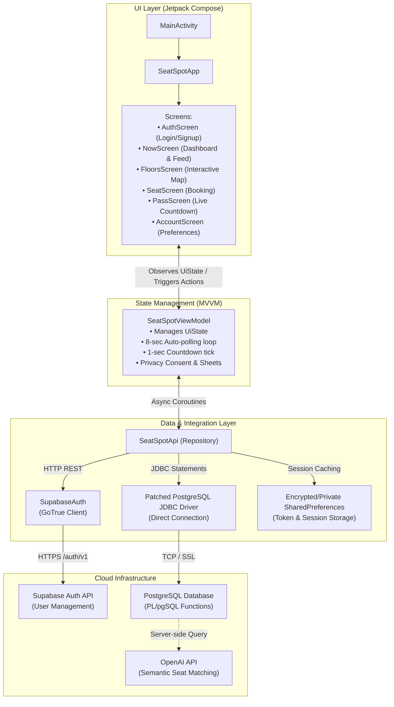
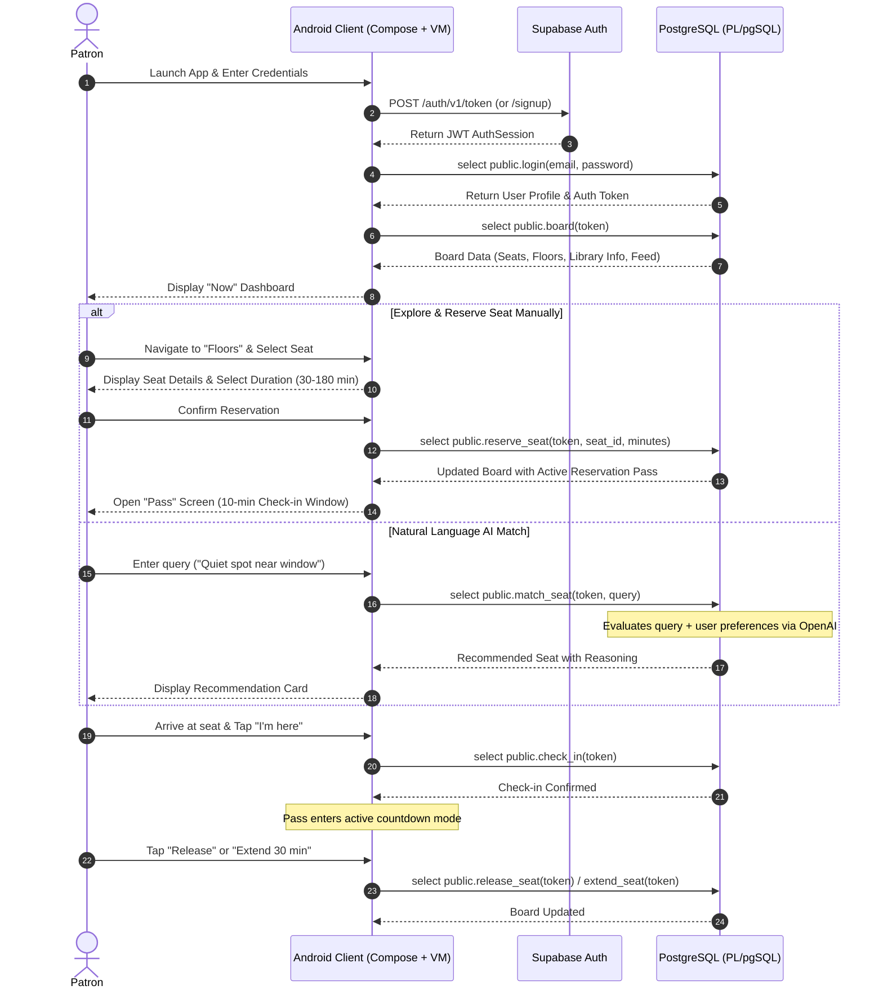
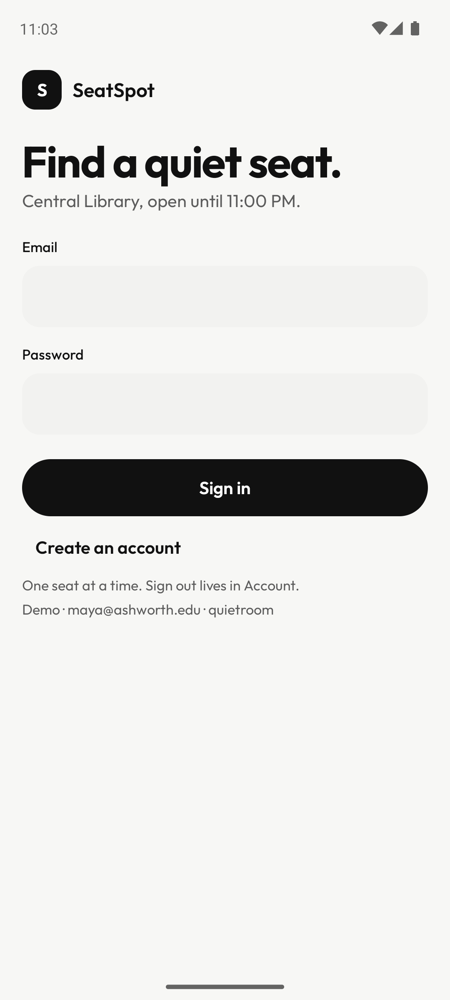
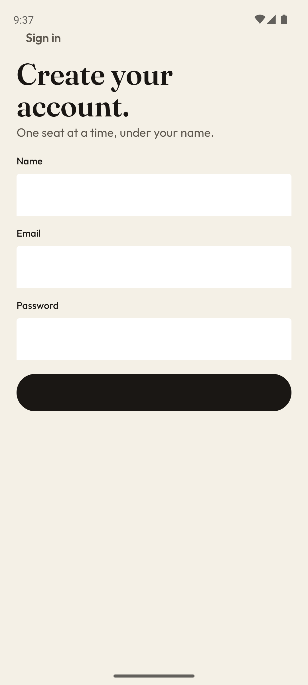
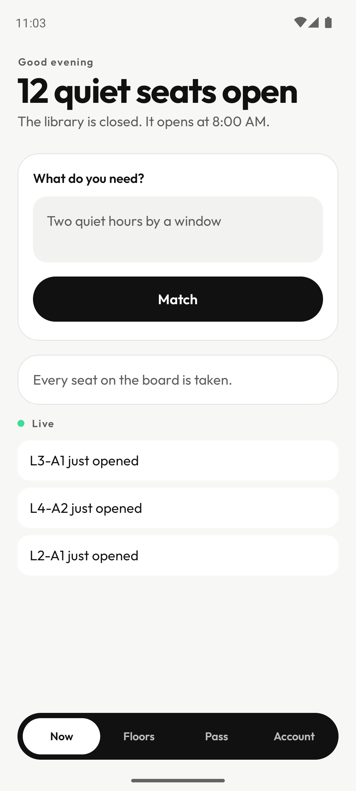
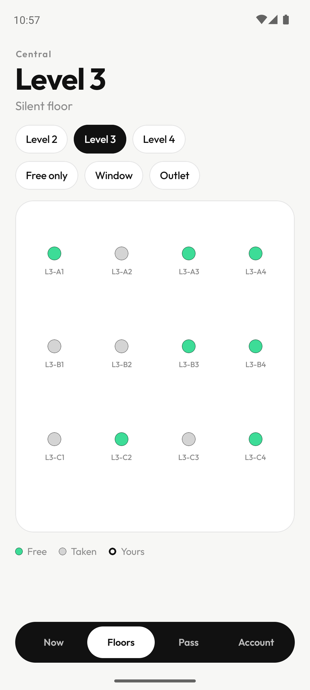
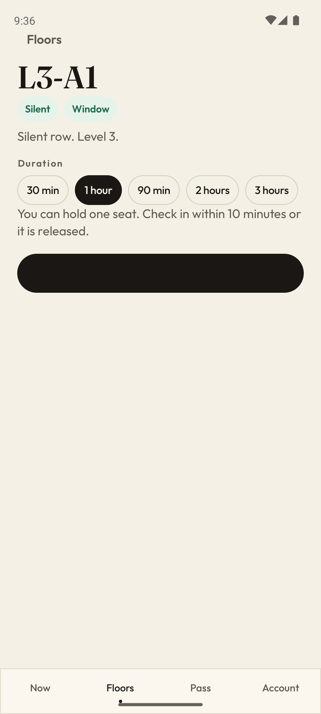
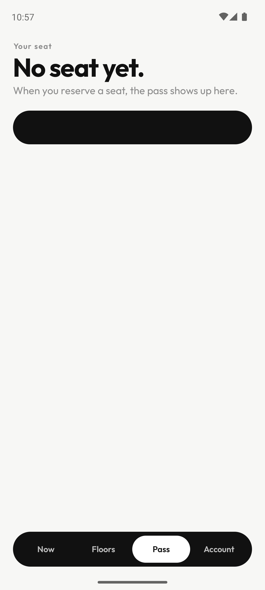
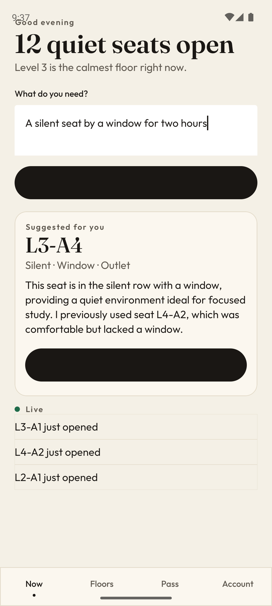
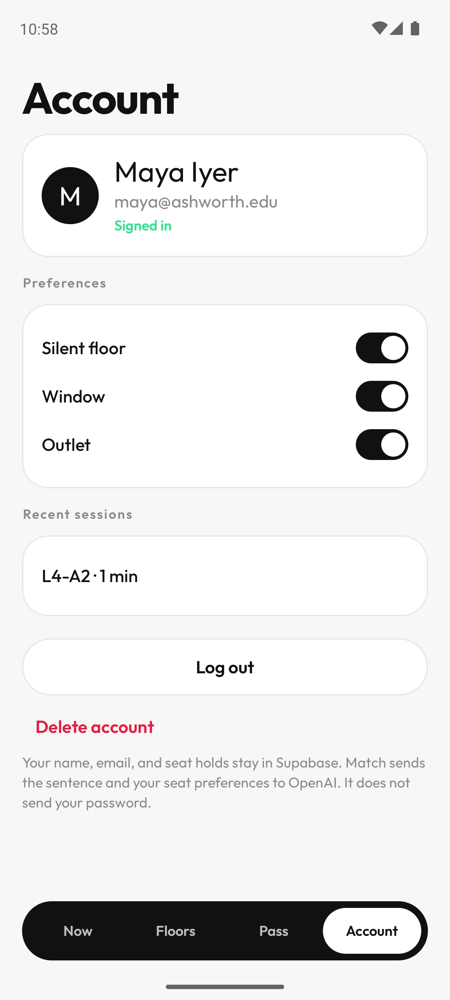

# SeatSpot 🪑📖

[](https://www.android.com/)
[](https://kotlinlang.org/)
[](https://developer.android.com/jetpack/compose)
[](https://www.postgresql.org/)
[](https://supabase.com/)

> **SeatSpot** is a native Android application built for smart library seat management and real-time study space reservation. Designed with Jetpack Compose and Material 3, SeatSpot helps library patrons discover quiet study zones, inspect interactive multi-floor seat availability, hold seats with automatic check-in timers, and match with the ideal study spot using AI natural language search.

---

## 📑 Table of Contents
1. [Project Overview & Objective](#-project-overview--objective)
2. [Key Features](#-key-features)
3. [Technology Stack & Frameworks](#-technology-stack--frameworks)
4. [Application Architecture](#-application-architecture)
5. [Application Workflow](#-application-workflow)
6. [Database Structure & Functions](#-database-structure--functions)
7. [APIs & Third-Party Integrations](#-apis--third-party-integrations)
8. [Project Folder Structure](#-project-folder-structure)
9. [Screenshots](#-screenshots)
10. [Configuration & Environment Variables](#-configuration--environment-variables)
11. [Prerequisites & Getting Started](#-prerequisites--getting-started)
12. [Build & Execution Commands](#-build--execution-commands)
13. [Authentication & Security](#-authentication--security)
14. [License & Attribution](#-license--attribution)

---

## 🎯 Project Overview & Objective

Libraries and shared study environments frequently suffer from crowded floors, seat hogging, uncertainty over quiet zone availability, and lack of visibility into available amenities such as power outlets and natural window lighting.

**SeatSpot** solves these issues through a focused, single-seat reservation model:
- **Real-Time Visibility**: Instant visibility into library hours, calm floors, and live available seats.
- **Fair Seat Usage**: Limits patrons to one seat reservation at a time with a strict 10-minute check-in grace period to prevent unattended seat hoarding.
- **Smart Space Matching**: Natural-language study requests evaluated against real-time seat attributes (noise level, window proximity, power outlet access).
- **Lightweight & Resilient Connectivity**: Direct PostgreSQL JDBC connectivity custom-patched for Android, combined with Supabase Auth for modern session management.

---

## ✨ Key Features

| Feature | Description |
| :--- | :--- |
| **Authentication & Profile** | User onboarding and login powered by Supabase GoTrue Auth with seamless fallback to database PL/pgSQL routines (`public.signup`, `public.login`). |
| **Live Dashboard ("Now")** | Displays library status (open/closed, closing time, timezone), count of open quiet seats, calmest floor indicator, rule-based recommendations, and real-time live event feed. |
| **AI Study Match ("Match")** | Natural-language query interface (e.g. *"Two quiet hours by a window"*) backed by OpenAI integration to recommend the best available seat. Requires explicit user privacy consent. |
| **Interactive Floor Plan ("Floors")** | 2D coordinate-based floor map showing seats positioned accurately on canvas across multiple library levels, with status indicators (*Free*, *Taken*, *Yours*). |
| **Smart Filtering** | Real-time interactive filter chips allowing patrons to filter floor plans by *Free only*, *Window*, and *Outlet*. |
| **Seat Booking ("Seat")** | Detailed seat inspection showing zone, noise category, description, and configurable hold duration (30, 60, 90, 120, or 180 minutes). |
| **Digital Study Pass ("Pass")** | Active reservation dashboard featuring countdown timer, distinct check-in verification code blocks, *"I'm here"* check-in button, *"Extend 30 min"* capability, and seat release. |
| **Intelligent Nudge Notifications** | Automatic contextual alerts delivered to the patron when a checked-in reservation has under 15 minutes remaining. |
| **Study Preferences** | Personalized study criteria (*Silent floor*, *Window*, *Outlet*) saved to user profile to automatically tailor recommendations. |
| **Session History** | Persistent log of recently completed study sessions with duration and seat identifier. |
| **Account Management** | Full account lifecycle support, including preference modification, logout, and permanent account deletion. |

---

## 🛠 Technology Stack & Frameworks

### Mobile Client (Android)
- **Language**: [Kotlin](https://kotlinlang.org/) `2.2.10` / Java 17
- **UI Toolkit**: [Jetpack Compose](https://developer.android.com/jetpack/compose) with Material 3 (`androidx.compose.material3`) via Compose BOM `2026.09.00`
- **Application Architecture**: MVVM (Model-View-ViewModel) with Android Lifecycle (`lifecycle-viewmodel-compose:2.11.0`, `activity-compose:1.13.0`)
- **Concurrency**: Kotlin Coroutines (`kotlinx-coroutines-android:1.10.2`)
- **JSON Serialization**: Kotlinx Serialization JSON (`kotlinx-serialization-json:1.9.0`)
- **Font & Styling**: Custom *Outfit* variable typography, clean custom palette (`Paper`, `Ink`, `Green`, `Accent`, `Danger`)

### Networking & Database
- **PostgreSQL JDBC**: `org.postgresql:postgresql:42.7.7` custom-patched for Android (`patchPostgresForAndroid` Gradle task replaces `PGPropertyMaxResultBufferParser` to eliminate `java.lang.management.ManagementFactory` runtime incompatibility).
- **Authentication Service**: [Supabase](https://supabase.com/) Auth GoTrue REST API (`/auth/v1`) via standard `HttpURLConnection`.
- **Database Engine**: [PostgreSQL](https://www.postgresql.org/) hosting PL/pgSQL stored procedures for library domain logic.
- **AI Matching**: [OpenAI](https://openai.com/) API integrated through server-side PostgreSQL function `public.match_seat()`.

### Build & Tooling
- **Build System**: Gradle 9.2.1 with Gradle Kotlin DSL (`build.gradle.kts`)
- **Android Gradle Plugin (AGP)**: `9.2.1`
- **Compile SDK**: `37` (Android 16 preview) | **Target SDK**: `36` | **Min SDK**: `26` (Android 8.0 Oreo)
- **Dependency Management**: Gradle Version Catalog (`gradle/libs.versions.toml`)
- **Testing**: JUnit 4, Kotlinx Coroutines Test, AndroidX Test JUnit & Espresso

---

## 🏛 Application Architecture

SeatSpot follows the standard Android Architecture Guidelines, enforcing a clean separation of concerns between UI, State Management, and Data layers:



### Key Architectural Highlights
1. **Patched JDBC Driver (`patchPostgresForAndroid`)**: The standard PostgreSQL JDBC driver invokes `java.lang.management.ManagementFactory`, a desktop Java package missing on Android. The project includes a dedicated Java file (`app/pgfix/PGPropertyMaxResultBufferParser.java`) and a custom Gradle task that unpacks `postgresql-42.7.7.jar`, compiles the drop-in replacement with JDK 17, and produces `postgresql-android.jar` before application build.
2. **Reactive Polling Loop**: `SeatSpotViewModel` executes a background coroutine loop polling `api.state()` every 8 seconds while active, updating floor vacancy and live seat activity seamlessly.
3. **Local Clock Tick**: Active reservation countdowns tick down locally every second via `tickClock()`, minimizing network traffic while ensuring accurate remaining seconds.

---

## 🔄 Application Workflow



---

## 🗄 Database Structure & Functions

SeatSpot encapsulates its business logic inside server-side PostgreSQL functions exposed under the `public` schema. The app communicates with PostgreSQL over JDBC:

### Stored Database Procedures

| Procedure Signature | Purpose |
| :--- | :--- |
| `public.login(email, password)` | Authenticates user against database records; returns auth token and user profile. |
| `public.signup(name, email, password)` | Creates a new user record in the library database. |
| `public.logout(token)` | Invalidates user session in the database. |
| `public.me(token)` | Retrieves current authenticated user profile and preferences. |
| `public.update_me(token, silent, window, outlet, match_consent)` | Updates study preferences (*silent*, *window*, *outlet*) and AI consent. |
| `public.delete_me(token)` | Permanently removes user account, holds, preferences, and session history. |
| `public.board(token)` | Aggregates full dashboard payload: library status, floors, seats, feeds, history, active pass. |
| `public.reserve_seat(token, seat_id, minutes)` | Holds a specific seat for the specified duration. |
| `public.check_in(token)` | Confirms arrival at the held seat within the 10-minute grace window. |
| `public.extend_seat(token)` | Extends current reservation by 30 minutes if available. |
| `public.release_seat(token)` | Releases current seat hold, recording the finished session in history. |
| `public.match_seat(token, query)` | Evaluates a natural language search query against vacant seats using OpenAI. |
| `public.nudge_seat(token)` | Generates contextual alert text for reservations expiring in <15 minutes. |

### Core Domain Models

- **`User`**: `id`, `name`, `email`, `silent` (boolean), `window` (boolean), `outlet` (boolean), `match_consent` (boolean).
- **`Seat`**: `id` (e.g. `L3-C4`), `floor` (int), `zone`, `noise` (*silent*, *collaborative*), `window` (boolean), `outlet` (boolean), `blurb`, `x` (coordinate %), `y` (coordinate %), `status` (*free*, *taken*, *yours*).
- **`Floor`**: `id`, `name` (*Level 1*, *Level 2*, *Level 3*), `tone`, `blurb`.
- **`Reservation`**: `seat_id`, `floor`, `zone`, `noise`, `window`, `outlet`, `starts_at`, `ends_at`, `checked_in`, `code`, `remaining_seconds`, `nudge`.
- **`StudySession`**: `seat_id`, `minutes`, `ended_at`.
- **`FeedItem`**: `text`, `at`.
- **`LibraryInfo`**: `name`, `open` (boolean), `closes_at`, `timezone` (e.g. `Asia/Kolkata`).

---

## 🌐 APIs & Third-Party Integrations

### 1. Supabase GoTrue Auth REST API
SeatSpot communicates with Supabase GoTrue Auth service over standard HTTPS:

| Method | Endpoint | Description |
| :--- | :--- | :--- |
| `POST` | `/auth/v1/signup` | Registers new user with email, password, and metadata (`name`). |
| `POST` | `/auth/v1/token?grant_type=password` | Obtains access token and refresh token via password grant. |
| `POST` | `/auth/v1/logout` | Revokes the current access token session. |
| `DELETE` | `/auth/v1/user` | Deletes user from Supabase identity management. |

### 2. OpenAI API Integration
Natural language seat queries entered on the **Now** screen are sent via `public.match_seat(token, query)`. The backend passes the request, vacant seat list, and user preferences to OpenAI to produce a recommendation with an explanatory `reason`.

---

## 📂 Project Folder Structure

```
SeatSpot/
├── app/
│   ├── build.gradle.kts                   # App build script, Android config, PG patch task
│   ├── proguard-rules.pro                 # R8 / ProGuard shrinkage rules
│   ├── pgfix/
│   │   └── PGPropertyMaxResultBufferParser.java # Patched JDBC class for Android runtime
│   └── src/
│       ├── main/
│       │   ├── AndroidManifest.xml        # Application manifest & permissions (INTERNET)
│       │   ├── java/com/seatspot/library/
│       │   │   ├── MainActivity.kt        # Entry point activity, Compose root setup
│       │   │   ├── data/
│       │   │   │   ├── Models.kt          # Domain data classes & exceptions
│       │   │   │   ├── SeatSpotApi.kt     # Repository for JDBC & Supabase interactions
│       │   │   │   └── SupabaseAuth.kt    # GoTrue HTTP client implementation
│       │   │   └── ui/
│       │   │       ├── Screens.kt         # Jetpack Compose UI screens & components
│       │   │       ├── SeatSpotViewModel.kt# MVVM ViewModel managing application state
│       │   │       └── theme/
│       │   │           └── Theme.kt       # Color scheme, Outfit typography & theme
│       │   └── res/                       # Drawables, mipmaps, font (outfit.ttf), strings
│       └── test/                          # Unit tests (SeatSpotApiTest.kt)
├── dist/                                  # Production bundle (.aab) & store assets
├── gradle/
│   ├── libs.versions.toml                 # Version Catalog for dependencies & plugins
│   └── wrapper/                           # Gradle Wrapper (gradle-wrapper.jar, properties)
├── screenshots/                           # UI screenshots referenced in documentation
├── .gitignore
├── build.gradle.kts                       # Root project build configuration
├── gradle.properties                      # JVM args & AndroidX flags
├── gradlew                                # Linux/macOS Gradle wrapper
├── gradlew.bat                            # Windows Gradle wrapper
├── settings.gradle.kts                    # Project & repository settings
└── README.md                              # Project documentation
```

---

## 📸 Screenshots

| Sign In | Sign Up | Dashboard ("Now") |
| :---: | :---: | :---: |
|  |  |  |

| Interactive Floor Plan | Seat Details & Booking | Digital Study Pass |
| :---: | :---: | :---: |
|  |  |  |

| AI Natural Language Match | Account & Preferences |
| :---: | :---: |
|  |  |

---

## ⚙️ Configuration & Environment Variables

SeatSpot requires database and authentication parameters supplied via a **`secrets.properties`** file in the root project directory. This file is intentionally omitted from version control to prevent credential leakage.

Create `secrets.properties` in the project root:

```properties
# PostgreSQL Database Connection
DB_URL=jdbc:postgresql://<your-db-host>:<port>/<database-name>?sslmode=require
DB_USER=<your-db-username>
DB_PASSWORD=<your-db-password>

# Supabase Auth Configuration
SUPABASE_URL=https://<your-project-id>.supabase.co
SUPABASE_ANON_KEY=<your-supabase-anon-public-key>
```

### Release Keystore Configuration (Optional)
If building signed release artifacts, create `keystore.properties` in the project root:

```properties
storeFile=release.keystore
storePassword=your_keystore_password
keyAlias=your_key_alias
keyPassword=your_key_password
```

---

## 📋 Prerequisites & Getting Started

### Prerequisites
- **Java Development Kit (JDK)**: Version 17 (Required for Gradle build and JDBC patch task).
- **Android Studio**: Android Studio Ladybug (2024.2+) or newer.
- **Android SDK**:
  - Compile SDK: `37`
  - Target SDK: `36`
  - Minimum SDK: `26` (Android 8.0 Oreo)
  - Android SDK Platform-Tools and Build-Tools installed.

### Setup Instructions
1. **Clone the Repository**:
   ```bash
   git clone https://github.com/nvsaigokul-sudo/SeatSpot.git
   cd SeatSpot
   ```

2. **Configure Secrets**:
   Copy and configure `secrets.properties` in the project root directory as shown in [Configuration](#-configuration--environment-variables).

3. **Open in Android Studio**:
   - Open Android Studio and choose **File → Open...**
   - Select the `SeatSpot` directory.
   - Let Gradle sync and download dependencies.

---

## 🚀 Build & Execution Commands

Run all commands using the Gradle wrapper from the project root:

### Windows (PowerShell / Command Prompt)
```powershell
# Run Unit Tests
.\gradlew.bat test

# Build Debug APK
.\gradlew.bat assembleDebug

# Install Debug APK onto connected device / emulator
.\gradlew.bat installDebug

# Build Production Android App Bundle (.aab)
.\gradlew.bat bundleRelease
```

### Linux / macOS
```bash
# Make gradlew executable
chmod +x gradlew

# Run Unit Tests
./gradlew test

# Build Debug APK
./gradlew assembleDebug

# Install Debug APK onto connected device / emulator
./gradlew installDebug

# Build Production Android App Bundle (.aab)
./gradlew bundleRelease
```

The compiled Debug APK will be located at:
```
app/build/outputs/apk/debug/app-debug.apk
```

---

## 🔒 Authentication & Security

- **Secrets Isolation**: All database URLs, credentials, and Supabase keys are injected into `BuildConfig` at compile time from `secrets.properties`, ensuring secrets never get committed to source control.
- **Credential Validation**: Email formats and password length (minimum 6 characters) are validated locally before dispatching network calls.
- **Sanitized Database Errors**: `dbMessage()` and `authMessage()` intercept raw SQL errors and API responses to prevent internal stack traces or database schema details from leaking to the UI.
- **Explicit AI Privacy Consent**: The application strictly enforces explicit user consent before transmitting any study query to OpenAI, explicitly informing the user that passwords and emails are never shared with third-party AI services.
- **Single Active Seat Policy**: Database stored procedures enforce one active seat reservation per user token, mitigating seat squatting.

---

## 📄 License & Attribution

- **Original Author & Source Repository**: [seethinajayadileep/SeatSpot](https://github.com/seethinajayadileep/SeatSpot)
- **Migrated & Maintained By**: [nvsaigokul-sudo/SeatSpot](https://github.com/nvsaigokul-sudo/SeatSpot)

All original project files, notices, and dependencies are preserved intact in this repository.
